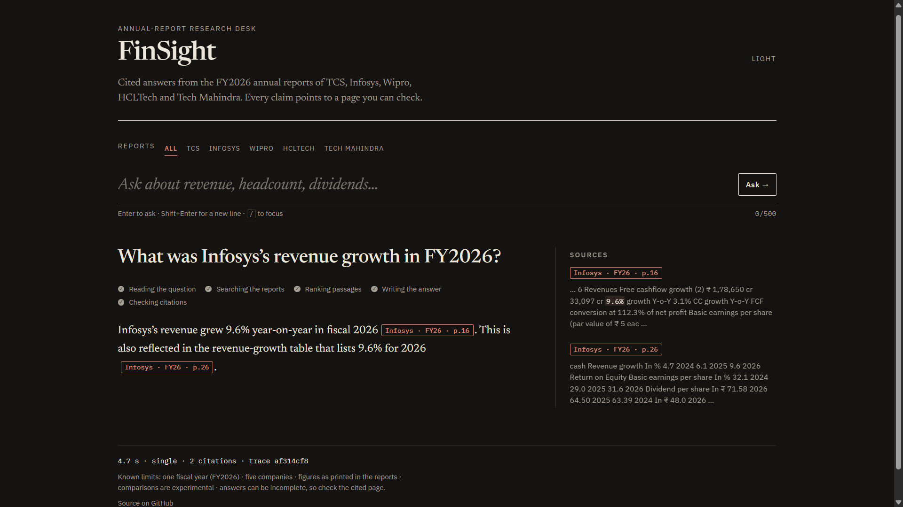
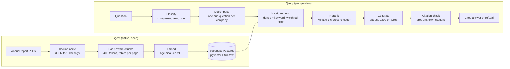

# FinSight

[](https://github.com/Ameen195/finsight-rag/actions/workflows/ci.yml)

**Ask questions about the FY2026 annual reports of five Indian IT companies and get answers with a
page-level citation for every figure.**



## What it does

- Answers questions about the FY2026 annual reports of TCS, Infosys, Wipro, HCLTech and Tech
  Mahindra, e.g. *"What was Wipro's voluntary attrition in FY26?"*
- Cites every claim as `[Company, FY, p.X]`, using the physical PDF page so you can check it.
- Compares companies ("Compare the total dividend per share of TCS and Infosys"), with one search
  per company.
- Refuses instead of guessing when the reports don't hold the answer, and streams the answer to
  a small web UI with the cited passages in a Sources panel.

## Architecture



The agent is a LangGraph graph, traced with Langfuse.

## Key design decisions

- **Page-aware chunking.** A chunk never crosses a page break, so each citation points to one
  exact page. Tables stay whole per page and keep their title line, and tiny tables are folded
  into the text around them. Sizes are counted with the embedding model's own tokenizer.
- **OCR only where needed.** TCS's PDF text layer is broken (split letters, dropped digits, ₹ read
  as "H"), so only TCS goes through full-page OCR. The other four use the text layer, which is
  faster and cleaner. Text inside charts and KPI tiles is re-parsed only on pages where Docling
  found clearly fewer digits than the PDF holds.
- **RRF with keyword weight 0.5.** On its own, keyword search is the weakest mode (Hit@5 0.375 vs
  dense 0.646), but it catches exact terms and figures that dense search misses. Hybrid at half
  keyword weight beats both (Hit@5 0.688).
- **MiniLM reranker for speed.** In the reranker speed test on the 16-question Infosys set
  (`eval/results/rerank_speed`),
  `ms-marco-MiniLM-L-6-v2` scored Hit@5 0.750 vs 0.625 for `bge-reranker-base`, with p50 latency
  of 1.4 s vs 7.8 s on CPU. Candidate pools of 30 and 50 were also tested; both scored lower and
  ran slower, so the pool stays at 20.
- **Refusal rules.** Answer only from the retrieved context, else a fixed refusal sentence. The
  citation check drops citations that match no retrieved chunk; no valid citation means refusal.
  A low-reranker-score refusal exists but is off, as it refused answerable questions.

## Results

Eval set: 67 hand-verified questions (56 answerable, 11 unanswerable) across the five reports.
Full reports: [`eval/results/all_companies/retrieval.md`](eval/results/all_companies/retrieval.md)
and [`eval/results/answers.md`](eval/results/answers.md).

**Retrieval** (48 single-company questions, k=10, exact page):

| Mode | Hit@1 | Hit@5 | MRR@10 | p50 / p95 latency |
|---|---|---|---|---|
| dense | 0.250 | 0.646 | 0.399 | 63 / 114 ms |
| keyword | 0.146 | 0.375 | 0.267 | 49 / 131 ms |
| hybrid | 0.354 | 0.688 | 0.494 | 90 / 203 ms |
| **hybrid + rerank** | **0.375** | **0.750** | **0.514** | 1,249 / 2,710 ms |

**Answers** (full agent, gpt-oss-120b; LLM judge gpt-oss-20b for explanation and comparison rows):

- Answer correctness: **66.1% of 56 answerable questions**. This rises to **67.9%** when the three questions that name no
  company are run with the company filter set, as a user would set it in the UI.
- Unanswerable questions refused: **100%** (11 of 11).
- Citations pointing to a retrieved passage: **100%**; on the expected page 60.8% exact, 62.7%
  within ±1 (half the "wrong" pages also hold the figure). Judge faithfulness 0.556.

| Group | n | Correct | False refusals | Citation on expected page (exact / ±1) |
|---|---|---|---|---|
| TCS | 10 | 0.875 | 0 | 0.750 / 0.750 |
| Infosys | 19 | 0.750 | 1 | 0.533 / 0.533 |
| HCLTech | 10 | 0.750 | 1 | 0.857 / 0.857 |
| Wipro | 10 | 0.625 | 2 | 0.833 / 0.833 |
| Tech Mahindra | 10 | 0.625 | 2 | 0.429 / 0.429 |
| Comparison | 8 | 0.375 | 4 | 0.375 / 0.500 |
| *fact* | 26 | 0.615 | 5 | 0.762 / 0.762 |
| *table* | 17 | 0.882 | 1 | 0.562 / 0.562 |
| *explanation* | 5 | 0.800 | 0 | 0.500 / 0.500 |

## Known limits

- **Comparisons are weak: 38% correct.** Each company gets fewer retrieved chunks, and the right
  page is often missing for one side.
- **Retrieval is the main failure cause.** In 14 of the 21 failed rows, the right page was not
  retrieved, which led to a refusal or a figure taken from another page. In 4 more rows the page
  was retrieved but the model picked the wrong figure (e.g. EPS reported as the dividend). See
  [`docs/ERROR_ANALYSIS.md`](docs/ERROR_ANALYSIS.md).
- **One fiscal year only (FY2026).** There is no trend analysis across years.
- **OCR noise on TCS.** "–" (nil) cells come out blank, and ₹ is sometimes lost from unit labels.
  Recovered chart text adds bare number runs from chart axes. Wipro's ₹ sign is extracted as a
  letter and left as is.
- **Small eval set.** 67 questions is enough to spot regressions, not to claim exact accuracy.
  One wrong answer moves a company's score by 10 percentage points.

## Tech stack (all free tier)

| Part | Choice | Free-tier note |
|---|---|---|
| Parsing | Docling + RapidOCR, pypdfium2 | local, CPU |
| Embeddings, reranker | bge-small-en-v1.5, ms-marco-MiniLM-L-6-v2 | local, CPU |
| Database | Supabase Postgres + pgvector (HNSW) + full-text search | free project pauses after 7 idle days; a weekly GitHub Action pings it |
| LLMs | Groq: gpt-oss-120b (answers), gpt-oss-20b (classifier, judge) | free rate limits; a client-side tokens-per-minute limiter and retries |
| Agent, tracing | LangGraph, Langfuse | Langfuse cloud free tier, optional |
| App | FastAPI (NDJSON streaming), plain HTML/CSS/JS | 10 questions per hour per IP |
| Run | locally or in Docker (CPU-only PyTorch image) | not hosted; optional guide in [`docs/DEPLOY.md`](docs/DEPLOY.md) |
| Tooling | uv, ruff, pytest, GitHub Actions | |

## Run locally (Windows, PowerShell)

```powershell
winget install astral-sh.uv
uv sync
Copy-Item .env.example .env   # then fill in GROQ_API_KEY and DATABASE_URL (Supabase session pooler)
uv run python scripts/smoke.py   # checks the DB, pgvector and Groq
# once: run scripts/schema.sql in Supabase; put the PDFs in data/raw/ as in config/manifest.yaml
uv run finsight-ingest                     # or --company TCS; parses are cached in data/parsed/
uv run uvicorn finsight.api.main:app --port 7860   # open http://localhost:7860
uv run python scripts/ask.py "What was TCS's revenue in FY2026?"   # CLI alternative
```

## Run the tests and evals

```powershell
uv run pytest; uv run ruff check .          # offline, no keys needed (CI runs these)
uv run python eval/eval_retrieval.py --out-dir eval/results/all_companies   # no LLM calls
uv run python eval/eval_answers.py --oracle-company   # full agent + judge, ~2.6k Groq tokens/question
```

The answer eval caches answers by git commit, so a stopped run resumes; `--max-tokens` caps spend.
